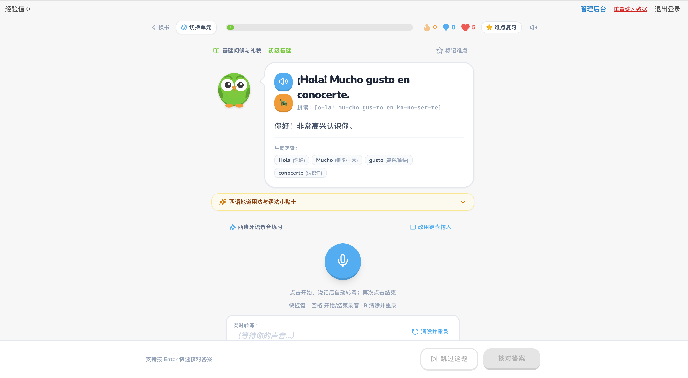

# HablaEspañol · 西班牙语口语练习

面向中文用户的西班牙语口语练习应用，提供示范朗读、录音转写、逐词比对和难点复习，配合红心、经验值、宝石及连胜记录完成日常训练。

项目使用 **React + TypeScript + FastAPI + MySQL**。语音服务在 **macOS 宿主机原生运行**：**mlx-audio / Ming 3.0 TTS 0.5B** 使用 Metal 提供 TTS，**faster-whisper / CTranslate2** 使用 CPU int8 提供 STT。Web、业务 API 和数据库使用 Docker Compose 部署。

## 功能

- **管理员教材后台**：书籍 → 章节 → 句子三级管理，响应式面包屑、封面和章节 Emoji、生词卡片动态增删，内容保存在数据库并直接用于练习。
- **中文练习界面**：按单元选择题目，查看中文释义、拼读提示、语法说明和词汇提示。
- **西语示范朗读**：支持正常速度、0.6 倍慢速及单词试听，统一使用 Ming 3.0 TTS 0.5B 西语音色。
- **录音过程转写**：浏览器通过 AudioWorklet 连续采集声音，定期上传完整 WAV 快照，录音中更新识别文本，结束后补全最终结果。
- **键盘输入**：支持手动输入和西班牙语特殊字符快捷键。
- **逐词比对**：展示匹配词、识别差异和遗漏词，按转写文本完整度评分，75 分通过。
- **账户与难点复习**：注册、登录、收藏题目及复习；账户、收藏、答题记录和成长数据保存在 MySQL。
- **练习奖励**：初始 5 颗红心；每道题首次通过奖励 15 XP 和 2 颗宝石，未通过扣 1 颗红心。可用 10 颗宝石补满，或在最后一次练习 30 分钟后免费补满。
- **浏览器音效**：使用 Web Audio API 合成操作和答题音效，音效偏好保存在浏览器。

评分基于 faster-whisper 转写文本与标准答案的逐词对齐，忽略大小写、元音重音和标点，保留 `ñ` 与 `n` 的区别，额外识别词也会影响得分。它用于辅助练习，不是音素、韵律或口音准确度测评。

## 技术栈

| 层级 | 技术与职责 |
| --- | --- |
| 前端 | React 19、TypeScript 5、Vite 6 |
| 界面 | Tailwind CSS 4、Lucide React、自定义 SVG 与 CSS 动画 |
| 浏览器音频 | AudioWorklet、Web Audio API、HTML Audio；负责录音、音效和播放 |
| 业务 API | Python 3.12、FastAPI、Uvicorn、Pydantic |
| 数据与迁移 | MySQL 8.4、SQLAlchemy 2、PyMySQL、Alembic |
| 登录认证 | Argon2 密码哈希、HttpOnly 会话 Cookie |
| 原生语音 | mlx-audio 0.6.5、MLX 0.32.4、Ming 3.0 TTS 0.5B；faster-whisper 1.2.1、CTranslate2 4.8.5 |
| 音频处理 | PyAV 解码与重采样、SoundFile 输出 PCM WAV、PyAV atempo 保留音高变速 |
| 部署与代理 | Docker Compose、Nginx、Docker Desktop 宿主机网络 |
| 测试 | pytest、FastAPI TestClient、Node.js test runner |

## 运行架构

```text
浏览器 http://localhost:3000
  │ 页面、录音、音频播放
  ▼
Docker Desktop
  Nginx / Web ── /api ──► FastAPI ──► MySQL
                            │
                            │ http://host.docker.internal:8001
                            ▼
macOS 宿主机 · 原生 Python 进程
  原生语音服务
    ├── mlx-audio / Ming 3.0 TTS 0.5B / Metal：TTS → 44.1kHz PCM WAV
    └── faster-whisper / CTranslate2 / CPU int8：STT → 转写文本
```

Ming bf16 模型文件约 3GB，运行时还需额外内存。慢速朗读通过 PyAV atempo 保留音高变速，复用原速合成结果，避免重复推理。

模型常驻宿主机内存，TTS 与 STT 共用一个推理锁，繁忙时返回 HTTP 503；合成音频使用最多 8MB 的内存缓存。浏览器通过已登录的同源 API 访问语音功能。

录音支持 WAV、WebM、MP4 和 Ogg，单次上传最多 8MB、音频最长 60 秒，浏览器录音在 55 秒自动结束。录音解码与推理在内存中完成；转写文本作为答题记录保存在数据库。

## 快速启动

### 环境要求

- Apple Silicon Mac，原生 arm64 macOS，可使用 Metal。
- Python 3.12 与 [uv](https://docs.astral.sh/uv/)。
- Docker Desktop 和 Docker Compose v2。
- 首次安装和下载模型需要网络，模型缓存大小取决于所选模型；运行内存需求取决于模型和设备。
- 支持麦克风、AudioWorklet 和 Web Audio API 的现代浏览器。录音需要 `localhost` 或 HTTPS 安全上下文。

本地修改前端时还需要 Node.js 22 和 npm；使用 Docker 构建 Web 时无需在宿主机安装 Node.js。

### 1. 配置业务服务

在项目根目录执行：

```sh
cp .env.example .env
```

编辑 `.env`，将 `MYSQL_PASSWORD` 和 `MYSQL_ROOT_PASSWORD` 替换为两组不同的随机十六进制密码。本地 HTTP 使用：

```dotenv
APP_ORIGIN=http://localhost:3000
COOKIE_SECURE=false
SPEECH_URL=http://host.docker.internal:8001
```

`.env` 由 Docker Compose 读取，不会自动加载到原生语音启动脚本。

### 2. 安装并启动原生语音服务

```sh
uv venv --python 3.12 speech/.venv
uv pip install --python speech/.venv/bin/python -r speech/requirements.txt
./scripts/start-speech.sh
```

首次启动会从 Hugging Face 下载 Ming 3.0 TTS 0.5B 和 faster-whisper 模型，默认缓存到 `.local-test/huggingface`（faster-whisper 在其 `faster-whisper` 子目录）。等待出现 `Application startup complete`，并保持该终端运行。

脚本默认监听 `127.0.0.1:8001`，只启动一个 worker。重启 Mac 或结束进程后，需要重新运行启动脚本；项目没有安装开机自启动项。

### 3. 启动 Web、API 和数据库

另开终端，在项目根目录执行：

```sh
curl --fail http://127.0.0.1:8001/health

docker compose up -d mysql
docker compose --profile setup run --build --rm init
docker compose up -d --build --remove-orphans api web
```

打开 [http://localhost:3000](http://localhost:3000)，注册账户并开始练习。密码至少 12 位。`init` 执行数据库迁移并同步题库；API 的健康检查同时验证数据库和原生语音服务是否就绪。

### 4. 检查与停止

```sh
# 检查应用健康状态
curl --fail http://localhost:3000/api/health

# 查看容器与业务日志
docker compose ps
docker compose logs --tail=100 api web

# 停止容器，保留 MySQL 数据卷
docker compose down
```

原生语音服务在其运行终端按 `Ctrl+C` 停止。`docker compose down -v` 会删除数据库卷，不用于日常停止。

## 配置项

### 业务服务：`.env`

| 变量 | 默认值或用途 |
| --- | --- |
| `MYSQL_PASSWORD` | 必填，业务数据库密码 |
| `MYSQL_ROOT_PASSWORD` | 必填，数据库 root 密码 |
| `APP_ORIGIN` | `http://localhost:3000`，校验写请求来源 |
| `COOKIE_SECURE` | 示例配置为 `false`；HTTPS 部署应设为 `true` |
| `SPEECH_URL` | Compose 默认 `http://host.docker.internal:8001`；宿主机直接运行 API 时默认 `http://127.0.0.1:8001` |
| `ADMIN_EMAIL` | 管理员登录邮箱；API 启动时自动创建，拥有清空练习数据权限 |
| `ADMIN_PASSWORD` | 管理员密码，12–128 位；仅保存在服务端环境变量，数据库保存哈希 |

### 原生语音服务：启动环境变量

| 变量 | 默认值 |
| --- | --- |
| `TTS_MODEL` | `mlx-community/Ming-3.0-tts-0.5B-bf16` |
| `TTS_VOICE` | 留空，使用模型默认音色；可设置 `UK_Charlotte` 等内置音色 |
| `STT_MODEL` | `small` |
| `SPEECH_HOST` | `127.0.0.1` |
| `SPEECH_PORT` | `8001` |
| `HF_HOME` | 项目目录下的 `.local-test/huggingface` |
| `HF_HUB_DISABLE_XET` | `1`，默认使用普通 HTTP 下载模型 |

例如，指定兼容的本地模型路径：

```sh
TTS_MODEL=/absolute/path/to/ming \
STT_MODEL=/absolute/path/to/whisper \
./scripts/start-speech.sh
```

当前语音实现按 Ming 3.0 TTS 0.5B 与 faster-whisper 的接口编写，TTS 使用语言代码 `es`，可选 Ming 内置音色，STT 固定 `es`，使用 CPU int8 并启用 VAD。STT 模型应为 faster-whisper 支持的名称或 CTranslate2 格式的本地目录。更换模型时需确认接口兼容。

## 本地开发

前端开发服务器固定在 3000 端口，将 `/api` 代理到宿主机的 `127.0.0.1:8000`：

```sh
npm ci
npm run dev
```

配合宿主机 API 开发时，先启动原生语音服务，并准备可访问的 MySQL 数据库。默认 Compose 不暴露 MySQL 或 API 端口，因此仅执行 `npm run dev` 不会启动完整应用。

```sh
uv venv --python 3.12 backend/.venv
uv pip install --python backend/.venv/bin/python -r backend/requirements.txt

cp .env.development.local.example .env.development.local
# 编辑 .env.development.local，填写本地数据库和管理员凭据。
npm run dev:backend:migrate  # 单独执行迁移（启动命令也会自动执行）
# npm run dev:backend:seed   # 可选：首次需要示例题库时手动执行
npm run dev:backend
```

开发后端配置保存在项目根目录 `.env.development.local`，由 `backend/dev.py` 在启动、迁移和 seed 前统一加载；也可直接运行 `backend/.venv/bin/python backend/dev.py [serve|migrate|seed]`，不受当前工作目录影响。已有进程环境变量优先于文件配置。修改配置后重启后端生效。

文件包含 `DATABASE_URL`、`APP_ORIGIN`、`COOKIE_SECURE`、`SPEECH_URL`、`ADMIN_EMAIL`、`ADMIN_PASSWORD`、`BACKEND_HOST` 和 `BACKEND_PORT`。默认监听 `127.0.0.1:8000` 并开启代码热重载，匹配 Vite 的代理配置。使用其他后端端口时需同步调整 Vite 代理。

示例数据库地址要求本机已有 MySQL 监听 3306。`.env.development.local` 已被 Git 忽略；只有无真实凭据的 `.env.development.local.example` 提交到仓库。后端变量不使用 `VITE_` 前缀，不会暴露给前端；Docker Compose 仍读取 `.env`。

## 测试与验证

以下命令在项目根目录运行：

```sh
# 前端类型检查、语音行为测试与生产构建
npm ci
npm run lint
npm run test:speech
npm run build

# 后端接口与原生语音工作进程测试
uv pip install --python speech/.venv/bin/python -r speech/requirements-dev.txt
PYTHONPATH=backend speech/.venv/bin/python -m pytest backend/tests speech/tests -q
```

后端测试使用 SQLite 和替身模型；语音服务测试覆盖真实音频解码、时长限制、静音处理、并发锁和 WAV 缓存。它们不验证 MySQL 行锁或真实模型识别质量。

启动对应服务后，可进一步验证真实链路：

```sh
# 仅需原生语音服务：Ming 3.0 TTS 0.5B、faster-whisper、慢速与缓存
speech/.venv/bin/python scripts/native_speech_smoke_test.py

# 需要完整应用：登录后的句子、慢速与单词朗读
speech/.venv/bin/python scripts/tts_smoke_test.py

# 需要完整应用：MySQL 业务流程、真实转写与评分
speech/.venv/bin/python scripts/smoke_test.py --audio /absolute/path/to/spanish.wav
```

后两项会创建独立测试账户。验证记录与部署细节见 [DEPLOYMENT.md](DEPLOYMENT.md)。

## 项目结构

```text
├── src/
│   ├── App.tsx                      # 登录状态与练习流程
│   ├── components/                  # 录音、题目、逐词比对、收藏及账户界面
│   ├── services/
│   │   ├── api.ts                   # 业务 API 客户端
│   │   ├── speechService.ts         # 录音转写与 TTS 播放
│   │   ├── pcm-recorder.worklet.js   # 连续音频采集
│   │   ├── pcmAudio.ts              # PCM 重采样与 WAV 编码
│   │   └── soundEffects.ts          # 浏览器音效
│   └── data/books.ts                # 后端目录展示适配与分书练习状态类型
├── backend/
│   ├── app/
│   │   ├── main.py                  # 认证、题库、答题和语音代理接口
│   │   ├── db.py                    # 数据模型与数据库连接
│   │   ├── speech.py                # 原生语音服务 HTTP 桥接
│   │   ├── scoring.py               # 服务端逐词对齐与评分
│   │   ├── book.json                # 与后台导出格式一致的示例书籍种子
│   │   ├── book_format.py           # 后台导入与 seed 共用的格式校验
│   │   ├── seed.py                  # 导出格式书籍的校验与幂等同步
│   │   └── reset.py                 # 管理员全库练习重置
│   ├── migrations/                  # Alembic 数据库迁移
│   ├── tests/
│   └── Dockerfile
├── speech/
│   ├── server.py                    # macOS 原生 Ming 3.0 TTS 0.5B / faster-whisper 服务
│   ├── requirements.txt             # 原生运行依赖
│   ├── requirements-dev.txt         # 测试依赖
│   ├── tests/
│   └── THIRD_PARTY.md               # 模型与第三方许可说明
├── scripts/                         # 原生启动脚本与真实链路冒烟测试
├── deploy/nginx.conf                # 同源反向代理及限流
├── compose.yaml                     # MySQL、初始化任务、API 和 Web
├── Dockerfile                       # 前端构建及 Nginx 镜像
├── .env.example                     # 业务环境配置示例
└── DEPLOYMENT.md                    # 部署、迁移与验证记录
```

## 题库与数据维护

默认 seed 文件为 `backend/app/book.json`，采用后台“一键导出”的 `habla-espanol-book` 版本 1 格式。示例包含一本书、6 个章节、23 个句子；不含封面图片或地址。运行时教材仍从数据库经 `/api/catalog` 获取。

开发环境初始化（在项目根目录执行，自动读取 `.env.development.local`）：

```sh
npm run dev:backend:migrate
npm run dev:backend:seed
# 指定其他后台导出的书籍文件：
npm run dev:backend:seed -- --file ./path/to/exported-book.json
```

直接运行 Python（须已设置数据库环境变量）：

```sh
cd backend
.venv/bin/python -m app.seed                  # 默认 app/book.json
.venv/bin/python -m app.seed --file /absolute/path/book.json
```

Docker 初始化默认导入镜像中的 `app/book.json`；修改示例文件后重新构建初始化服务：

```sh
docker compose --profile setup run --build --rm init
```

格式示例（完整字段见 `backend/app/book.json`）：

```json
{
  "format": "habla-espanol-book",
  "version": 1,
  "book": {
    "id": "example-book",
    "name": "示例教材",
    "description": "入门练习",
    "chapters": [{
      "id": "example-chapter",
      "name": "问候",
      "description": "日常问候",
      "icon": "👋",
      "sentences": [{
        "id": "example-sentence",
        "chapterId": "example-chapter",
        "name": "你好",
        "spanish": "¡Hola!",
        "chinese": "你好！",
        "phonetics": "o-la",
        "grammarTip": "Hola 用于打招呼。",
        "difficulty": "easy",
        "vocabHints": [{"es": "Hola", "chinese": "你好"}]
      }]
    }]
  }
}
```

`exportedAt` 可选，忽略其时间值。seed 与后台导入共用完整校验，拒绝格式/版本错误、重复章节或句子 ID、错配的 `chapterId`；最多 5 MB、1000 个章节和 10000 个句子。校验后在单个事务中保存，失败整体回滚。

seed 按导出文件中的 ID 插入或更新书籍、章节和句子，重复执行不会创建副本；保留账户、收藏、答题记录及文件之外的教材内容。已有封面保留，新书封面留空。ID 与其他书籍内容冲突时拒绝导入。建议保留导出 ID；缺少 ID 时按书名和章节/句子位置生成稳定 ID，此时修改书名或调整顺序会改变对应 ID。

后台“一键导入”仍会重新分配 ID 并创建独立副本，与 seed 的幂等同步不同。管理员全库重置是独立的破坏性操作：保留账户与密码，清空全库书籍、章节、句子及所有账户的练习记录、收藏和成长数据，再以 `book.json` 重建示例教材。数据库结构由 Alembic 管理，更新前应备份数据库和封面文件。

## 部署说明

- 默认只将 Web 映射到宿主机 `127.0.0.1:3000`；API 和 MySQL 在 Docker 网络内通信。
- 原生语音服务没有用户鉴权，默认绑定回环地址；业务鉴权在 FastAPI 完成。
- 模型首次下载后复用本地缓存；运行期间录音不会发送到第三方语音 API。
- 远程访问录音功能需要 HTTPS，并配置匹配的 `APP_ORIGIN` 和安全 Cookie。
- 原生服务重启后，API 健康检查会动态恢复；不要通过增加语音 worker 数量来扩容，以免重复加载模型。

完整部署、迁移和上线前检查见 [DEPLOYMENT.md](DEPLOYMENT.md)。第三方模型与音频依赖的许可见 [speech/THIRD_PARTY.md](speech/THIRD_PARTY.md)；重新分发时需遵守各组件的许可要求。

Ming 模型采用 [MIT](https://huggingface.co/mlx-community/Ming-3.0-tts-0.5B-bf16) 许可；代码与其他依赖按各自许可使用。

### 默认管理员

在 Docker 的 `.env` 或本地开发的 `.env.development.local` 中配置 `ADMIN_EMAIL` 和 `ADMIN_PASSWORD`，完成数据库迁移后启动 API，即可使用该邮箱和密码登录，无需手动注册。Docker Compose 要求这两个变量均已配置；本地直接运行 API 时，均不配置则跳过自动创建，仅配置一个或格式不合法会阻止启动。

重复启动保留账户及练习数据。修改 `ADMIN_PASSWORD` 后重启 API 会同步密码并撤销该管理员的旧登录会话。变量不得添加 `VITE_` 前缀或提交到版本库。

### 教材管理后台

使用 `ADMIN_EMAIL` 管理员登录后，点击页面顶部的“管理后台”。可新增、编辑、删除书籍、章节和句子；点击“管理章节”“管理句子”逐级进入，顶部面包屑可返回任一级。书籍支持名称、描述、封面图片地址，章节支持名称、描述、Emoji 图标，句子支持名称、西班牙语、中文、拼读、语法提示及多组生词卡片。后台的词汇字段为 `{ es, chinese }`，练习 API 兼容原有 `{ es, zh }`。

升级已有部署时，先备份数据库，然后执行迁移并重建 API 和 Web：

```bash
docker compose --profile setup run --build --rm init
docker compose up -d --build api web
```

迁移 `0002` 将已有题目归入书籍和章节，保留账户、收藏和答题记录。教材馆和单元选择器统一读取 `/api/catalog`，包含空书籍和空章节；无句子的内容展示为空且不可开始练习。前端不再内置题库、书名、级别或章节图标映射。删除书籍或章节前须清空其下级内容；删除句子同时删除其关联收藏和答题记录，已获得的 XP 和宝石保留。返回教材馆时刷新题库；若本次修改过教材，会重置当前页面缓存的练习位置和判题结果，避免引用已修改或删除的句子。

注意：手动执行 `app.seed` 会使用 `app/book.json` 更新同 ID 的书籍、章节和句子；“清空练习数据”会清空全库教材并用该示例书籍重建。

开发启动命令 `npm run dev:backend` 会先执行 `alembic upgrade head`，迁移成功后再启动 API 和初始化管理员；迁移失败则停止启动。不会自动运行 seed，因此重复启动不会覆盖后台编辑的教材。空数据库启动后可直接登录后台添加教材。

### 本地上传教材封面

在书籍表单中点击“上传本地封面”，可上传 JPG、PNG 或 WebP（最大 5 MB、1600 万像素），上传后自动填入地址并预览，点击“保存”后关联到书籍。也可继续填写外部图片地址。图片经服务端解码、缩放并转为 WebP 后存储，仅管理员可上传，登录用户可读取。

本地默认存储在 `backend/uploads/`，已加入 Git 忽略；可在 `.env.development.local` 中设置绝对路径 `UPLOAD_DIR`。Docker 使用持久卷 `cover_uploads` 保存封面，重建容器不会清空；备份时须同时备份数据库和封面卷。修改依赖后先重新安装 `backend/requirements.txt`，Docker 则重新构建 API。

### 一键导出书籍

在管理后台的书籍卡片点击“一键导出”，下载 UTF-8 JSON 文件。导出包含书籍名称、描述、全部章节（含空章节）、句子、拼读、语法提示、难度及生词数组；不包含封面图片文件或封面地址，也不包含账户、收藏、答题记录。接口为 `GET /api/admin/books/{book_id}/export`，仅管理员可用。导出内容以数据库中已保存的数据为准，文件包含格式名和版本号，便于识别。

### 一键导入书籍

点击管理后台顶部“一键导入”，选择之前导出的 `habla-espanol-book` 版本 1 JSON 文件（UTF-8，最大 5 MB）。导入书籍、章节（保留空章节）、句子、难度、拼读、语法提示和生词，成功后显示章节与句子数量并刷新书籍库。

导入总是创建独立副本并重新分配 ID，不覆盖已有书籍，也不导入图片、收藏或答题记录。整份文件先校验，再在单个事务内保存；校验失败不会留下部分书籍。每本书最多 1000 个章节、10000 个句子。接口为 `POST /api/admin/books/import`（multipart 字段 `file`），仅管理员可用。

### 可选句子图片

句子表单支持“上传句子图片”（JPG、PNG、WebP，最大 5 MB），上传后可预览、更换或移除，点击“保存”后生效。无图片时正常保存和练习；有图片时在后台句子卡片和练习题上方显示，练习端加载失败时隐藏图片区域。

句子 API 使用可选 `imageUrl` 字段，省略时更新会保留原图，传空字符串则移除。`POST /api/admin/sentence-images` 复用封面的验证与持久存储，返回图片地址。无需数据库迁移。书籍导出依然不包含图片文件或图片地址；导入不恢复图片，seed 更新保留已有句子图片。
